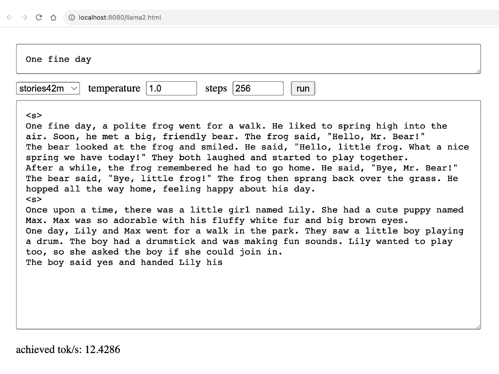

## llama2.c and llama2.js

<p align="center">
  
</p>

This repository contains Andrej Karpathy's C implementation of llama2 ([llama2.c](https://github.com/karpathy/llama2.c)) and a pure JavaScript port (llama2.js) with a simple UI.

Both versions use the same model files and tokenizer. The `tokenizer.py` script is used to generate `tokenizer.bin`, which is utilized by both the C and JavaScript implementations.

## How to run llama2.js
1. Download Karpathy's Llama2 ([Orig instructions](https://github.com/karpathy/llama2.c#feel-the-magic)) parameters pretrained on [TinyStories](https://huggingface.co/datasets/roneneldan/TinyStories) dataset. You will also need `tokenizer.bin` generated by `tokenizer.py`.

    ```bash
    wget https://huggingface.co/karpathy/tinyllamas/resolve/main/stories15M.bin
    wget https://huggingface.co/karpathy/tinyllamas/resolve/main/stories42M.bin
    wget https://huggingface.co/karpathy/tinyllamas/resolve/main/stories110M.bin
    # You will also need tokenizer.bin, which can be generated using tokenizer.py
    ```
2. Open run.html via a WebServer
   
   ```bash
    python -m http.server 8080
    open http://localhost:8080/run.html
    ```

## Running the C Version

To run the C version (`run.c`):

1.  **Compile the code:**
    *   **Using GCC:**
        ```bash
        gcc -O3 -o run run.c -lm -fopenmp
        ```
        (The `-fopenmp` flag enables OpenMP for parallelization.)
    *   **Using MSVC:**
        Use the `build_msvc.bat` script.
    *   **General:**
        Refer to the `Makefile` for more detailed compilation options and targets.

2.  **Download Model Files:**
    Ensure you have the Llama2 model checkpoint files (e.g., `stories15M.bin`, `stories42M.bin`, etc.) and the `tokenizer.bin` file in your working directory. `tokenizer.bin` can be generated using `tokenizer.py`.

3.  **Run the executable:**
    ```bash
    ./run <checkpoint_file> [temperature] [steps] [prompt]
    ```
    For example:
    ```bash
    ./run stories15M.bin 0.8 256 "Once upon a time"
    ```

## Performance (llama2.js)

Tokens/sec measurement on Apple M1 for the JavaScript version (llama2.js):

|    tok/s   | 15M | 42M | 110M |
|-------|-----|-----|-----|
| 🐢 |  ~30|   ~13   | ~5 |


## License
MIT
